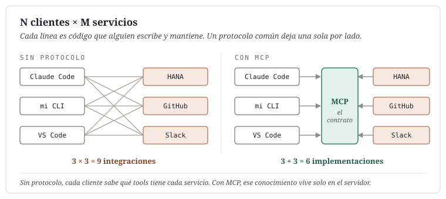
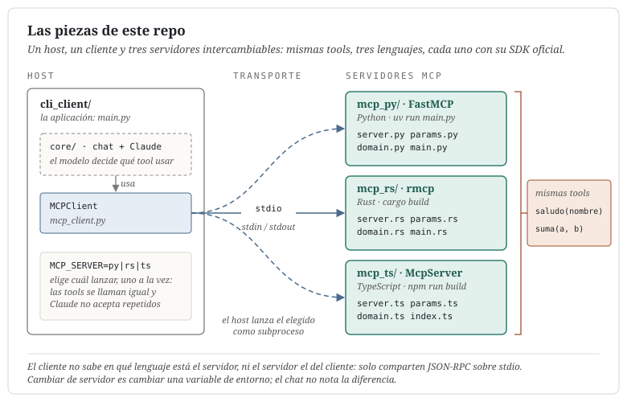
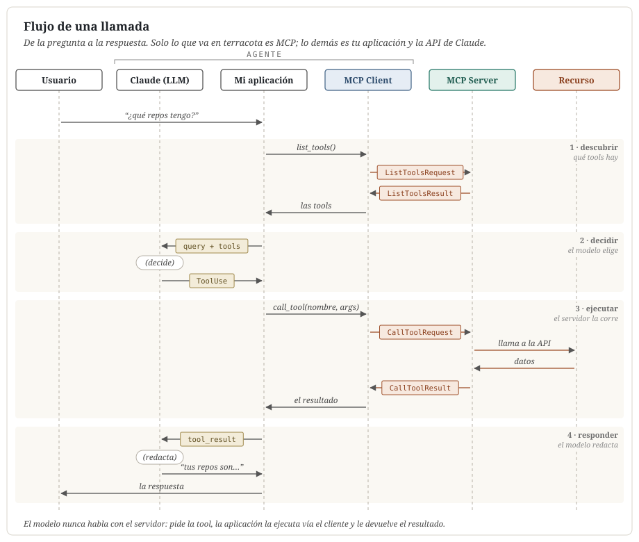

# Estudio de MCP

Un cliente y el mismo servidor MCP escrito tres veces, en Python, Rust y
TypeScript, para entender el protocolo desde los dos lados del cable.

```
estudio-mcps/
├── cli_client/   el host: chat en terminal con Claude + MCPClient
├── mcp_py/       servidor MCP en Python (mcp, con FastMCP)
├── mcp_rs/       servidor MCP en Rust (rmcp)
└── mcp_ts/       servidor MCP en TypeScript (@modelcontextprotocol/sdk)
```

Los tres usan el SDK oficial de su lenguaje, mantenido en la organización
[modelcontextprotocol](https://github.com/modelcontextprotocol) de GitHub.


## Qué es MCP

**Model Context Protocol** es un protocolo abierto para que una aplicación que
usa un LLM descubra y use capacidades que viven fuera de ella: consultar una
base de datos, leer documentos, llamar a una API. Por debajo es JSON-RPC 2.0
sobre un transporte: **stdio** (el host lanza el servidor como subproceso) o
**Streamable HTTP** (el servidor escucha en una URL).

Un servidor MCP no hace nada que no pudieras programar directo en tu
aplicación. Lo que cambia es **dónde vive el conocimiento** de qué puede hacer.


## El problema que resuelve

Imagina que quieres que un asistente consulte HANA. Escribes una función que se
conecta, corre el query y regresa las filas. Luego se la describes al modelo en
el formato que pide tu aplicación (el `tools=[...]` de la API de Claude, por
ejemplo) y la ejecutas cuando el modelo la pide. Funciona.

Después quieres lo mismo en Claude Code, en tu CLI y en el editor. Cada uno
tiene su propia forma de declarar tools, de ejecutarlas y de pasarles
credenciales, así que la integración se escribe tres veces. Si además quieres
GitHub y Slack, son tres integraciones más por cada cliente.

Lo que se repite no es el código que habla con HANA, que es el mismo en todos
lados, sino el **pegamento**: cada cliente tiene que saber qué tools existen,
cómo se llaman y qué argumentos reciben. Con N clientes y M servicios terminas
con **N×M** pegamentos, y cuando un servicio cambia una tool hay que tocar todos
los clientes que la usan. Ese es el acoplamiento.

Un protocolo común lo rompe. Cada servicio se envuelve **una vez** en un
servidor MCP que anuncia sus propias tools, y cada cliente aprende **una vez** a
hablar MCP. N×M pasa a **N+M**, y lo que sabe cada tool vive en un solo lugar:
su servidor.




## Ya había pasado antes: LSP

Los editores de código tuvieron exactamente este problema. Autocompletado, ir a
la definición, renombrar un símbolo: cada editor (Vim, Emacs, Sublime,
Eclipse…) necesitaba su propio soporte para cada lenguaje, casi siempre un
plugin escrito solo para él. Editores × lenguajes, y la mayoría de las
combinaciones quedaban a medias.

En 2016 Microsoft publicó, junto con VS Code, el **Language Server Protocol**.
La idea es que la inteligencia del lenguaje vive en un proceso aparte, el
*language server*, que habla JSON-RPC con el editor. El editor solo tiene que
entender el protocolo. `rust-analyzer`, por ejemplo, se escribió una vez y
funciona en VS Code, Vim, Zed o Helix sin que nadie lo haya portado.

MCP toma esa forma casi tal cual: JSON-RPC, un proceso aparte que puede hablar
por stdio, y un saludo inicial (`initialize`) donde las dos partes declaran qué
soportan. Si ya entiendes cómo un editor habla con un language server, ya
entiendes buena parte de MCP.


## Lo que MCP hace distinto

La diferencia está en **quién entiende los mensajes**. En LSP el vocabulario es
cerrado: el protocolo define `textDocument/completion`,
`textDocument/definition` y compañía, y el editor tiene código escrito para cada
uno. Un language server no puede inventar una operación nueva y esperar que el
editor sepa qué hacer con ella.

En MCP el vocabulario es abierto. El protocolo solo define cómo listar tools y
cómo llamarlas; las tools en sí las inventa cada servidor. Nadie escribió código
en Claude Code para `hana_query`. El servidor la anuncia en `tools/list` con un
nombre, un schema de argumentos y una descripción en prosa, y el modelo lee esa
descripción y decide si le sirve. El significado de la tool viaja en el mismo
mensaje que la anuncia.

Por eso MCP llegó ocho años después que LSP. La logística (JSON-RPC, procesos,
transportes) existía desde 2016. Lo que faltaba era un cliente capaz de leer un
menú que nunca había visto y decidir qué pedir, y ese cliente es el LLM.

> Consecuencia práctica: el contrato es **schema + prosa**. El schema lo dan los
> type hints; la prosa la escribes tú. Es lo único de tu servidor que el modelo ve.


## Las piezas

- **Host**: la aplicación que el usuario usa y que habla con el modelo. Aquí,
  `cli_client/`. En otros casos, Claude Code o Claude Desktop.
- **Cliente MCP**: vive dentro del host y mantiene la conexión con **un**
  servidor. Si el host usa dos servidores, tiene dos clientes.
- **Servidor MCP**: expone capacidades y las ejecuta contra el recurso real.
  No sabe nada del modelo ni del lenguaje en que está escrito el cliente.



Un servidor ofrece tres tipos de cosas. La diferencia está en **quién decide
usarlas**:

| Primitiva     | Quién la controla | Para qué                                  | En este repo                            |
|---------------|-------------------|-------------------------------------------|-----------------------------------------|
| **Tools**     | el modelo         | acciones que el modelo decide ejecutar    | `saludo`, `suma`, en los tres servidores |
| **Resources** | la aplicación     | datos que la app lee y mete al contexto   | pendiente                               |
| **Prompts**   | el usuario        | plantillas que el usuario elige invocar   | pendiente                               |


## Un servidor, tres lenguajes

Los tres servidores son el mismo: exponen `saludo(nombre)` y `suma(a, b)` con
los mismos nombres, descripciones y schemas. Por eso son intercambiables: el
chat elige cuál lanzar con `MCP_SERVER=py|rs|ts` y no nota la diferencia.

También están armados igual, en cuatro capas que van de afuera hacia adentro:

| Capa          | Qué hace                                          | Python        | Rust            | TypeScript      |
|---------------|---------------------------------------------------|---------------|-----------------|-----------------|
| **Arranque**  | conecta el servidor a un transporte (stdio)       | `main.py`     | `src/main.rs`   | `src/index.ts`  |
| **Arranque HTTP** | lo mismo, pero como ruta `/mcp` de un servidor web | —         | `examples/http.rs` (axum) | `examples/http.ts` (express) |
| **Servidor**  | la capa MCP: registra las tools y traduce         | `server.py`   | `src/server.rs` | `src/server.ts` |
| **Params**    | el contrato de entrada, del que sale el schema    | `params.py`   | `src/params.rs` | `src/params.ts` |
| **Dominio**   | la lógica, sin saber nada de MCP                  | `domain.py`   | `src/domain.rs` | `src/domain.ts` |

Lo único que cambia entre lenguajes es cómo se declara el schema:

- **Python**: type hints con `Annotated[int, Field(description=...)]`. Pydantic
  valida y FastMCP genera el schema.
- **Rust**: structs con `#[derive(Deserialize, JsonSchema)]`. serde valida y
  schemars genera el schema.
- **TypeScript**: objetos de zod con `.describe(...)`. zod valida y el SDK
  genera el schema.

En los tres, las descripciones terminan en `tools/list`, que es lo que lee el
modelo.

El transporte es la capa de más afuera, y por eso se puede cambiar sin tocar
nada más. En Rust y TypeScript hay un segundo arranque que sirve **el mismo
servidor** por Streamable HTTP en `http://127.0.0.1:8000/mcp`, en lugar de
stdio:

```bash
cd mcp_rs && cargo run --example http
cd mcp_ts && npm run http
```

Por HTTP el servidor ya no es un subproceso del host: corre por su cuenta y
cada cliente que se conecta abre una **sesión**, identificada con el header
`mcp-session-id`. Cada sesión tiene su propia instancia del servidor.
`cli_client` habla solo stdio; para probar estos ejemplos se usa
`streamablehttp_client` del SDK de Python o MCP Inspector.


## Flujo de una llamada

El modelo nunca habla con el servidor. Pide una tool, la aplicación la ejecuta
a través del cliente y le devuelve el resultado. Solo los mensajes en terracota
son MCP; el resto es la aplicación y la API de Claude.



1. **Descubrir.** Antes de cada llamada a Claude, la aplicación pide la
   lista de tools: `ListToolsRequest` → `ListToolsResult`. Cada tool trae
   nombre, schema de entrada y descripción en prosa.
2. **Decidir.** La aplicación manda a Claude la pregunta del usuario junto con
   esas tools. El modelo responde con un `ToolUse`: qué tool y con qué argumentos.
3. **Ejecutar.** La aplicación pasa ese pedido al cliente: `CallToolRequest` →
   el servidor llama al recurso → `CallToolResult`.
4. **Responder.** La aplicación devuelve el resultado al modelo como
   `tool_result`, y el modelo redacta la respuesta final.

<details>
<summary>La misma secuencia en texto</summary>

```
            ┌--------------- AGENTE ----------------┐

USUARIO   MODELO (LLM)      MI APLICACION       MCP CLIENT    MCP SERVER    RECURSO DE SW
  │         │                    │                  │              │           │
  │ ── "¿qué repos tengo?" ─────►│                  │              │           │
  │         │                    │                  │              │           │
  │         │                    │ ── listTools() ──►              │           │
  │         │                    │                  │ ─ ListToolsRequest ►     │
  │         │                    │                  │ ◄ ListToolsResult ──     │
  │         │                    │ ◄──── tools ─────│              │           │
  │         │                    │                  │              │           │
  │         │ ◄── query+tools ───│                  │              │           │
  │      (decide)                │                  │              │           │
  │         │ ─── ToolUse ──────►│                  │              │           │
  │         │                    │ ── callTool() ──►│              │           │
  │         │                    │                  │ ─ CallToolRequest ►      │
  │         │                    │                  │              │ ── API ──►│
  │         │                    │                  │              │ ◄─ data ──│
  │         │                    │                  │ ◄ CallToolResult ──      │
  │         │                    │ ◄─── result ─────│              │           │
  │         │ ◄── toolResult ────│                  │              │           │
  │      (redacta)               │                  │              │           │
  │         │ ─ "tus repos son..." ►                │              │           │
  │ ◄──── respuesta ─────────────│                  │              │           │
  │         │                    │                  │              │           │
```

</details>


## Correrlo

**Servidor Rust.** Hay que compilarlo antes, porque el host lanza el binario:

```bash
cd mcp_rs && cargo build
```

**Servidor TypeScript.** También se compila antes:

```bash
cd mcp_ts && npm install && npm run build
```

**Servidor Python.** No necesita compilarse; tiene su propio `pyproject.toml`
y se puede correr solo con `uv run main.py`.

**Host.** Necesita `ANTHROPIC_API_KEY` y `CLAUDE_MODEL` en `cli_client/.env`.
`MCP_SERVER` elige qué servidor lanzar (por omisión, `py`):

```bash
cd cli_client
MCP_SERVER=py uv run main.py
MCP_SERVER=rs uv run main.py
MCP_SERVER=ts uv run main.py
```

Se conecta a uno a la vez porque las tools se llaman igual en los tres, y la
API de Claude no acepta nombres de tool repetidos.


## Ejemplo de uso

### Desde el chat

Con el host corriendo (`MCP_SERVER=rs uv run main.py`, por ejemplo), escribe
una pregunta que necesite las tools:

```
> Saluda a Ana y dime cuánto es 1234 + 5678
```

Detrás de esa línea pasa lo del diagrama de flujo:

1. Antes de llamar a Claude, el host pide `tools/list` y recibe `saludo` y
   `suma` con sus descripciones.
2. Manda tu pregunta a Claude junto con esas dos tools.
3. Claude responde con dos `tool_use`: `saludo` con `{"nombre": "Ana"}` y
   `suma` con `{"a": 1234, "b": 5678}`.
4. El host ejecuta cada una con `tools/call` y obtiene `"hola, Ana"` y `"6912"`.
5. Devuelve los dos resultados a Claude (otra vez con la lista de tools, por
   si necesita más) y Claude redacta la respuesta final.

Cambia `MCP_SERVER` a `py` o `ts` y la conversación es la misma: el chat no
sabe en qué lenguaje está el servidor.

### Desde una sesión de Claude Code

Claude Code también es un host MCP, así que puede usar los tres servidores
directamente, sin pasar por `cli_client`. El repo trae un `.mcp.json` en la raíz
que los registra:

```json
{
  "mcpServers": {
    "estudio-py": { "command": "uv", "args": ["run", "--project", "mcp_py", "mcp_py/main.py"] },
    "estudio-rs": { "command": "mcp_rs/target/debug/mcp_rs", "args": [] },
    "estudio-ts": { "command": "node", "args": ["mcp_ts/dist/index.js"] }
  }
}
```

1. Compila Rust y TypeScript (ver [Correrlo](#correrlo)).
2. Abre Claude Code **desde la raíz del repo**, porque las rutas del
   `.mcp.json` son relativas a ella:

   ```bash
   cd estudio-mcps && claude
   ```

3. La primera vez, Claude Code pregunta si apruebas los servidores del
   proyecto. Acéptalos y revisa con `/mcp` que los tres aparezcan conectados.
4. Pide algo que use las tools, nombrando el servidor si quieres uno en
   particular:

   ```
   > Usa estudio-rs para saludar a Ana y estudio-ts para sumar 1234 + 5678
   ```

A diferencia de `cli_client`, aquí los tres pueden estar conectados a la vez:
Claude Code les pone prefijo a las tools con el nombre del servidor
(`mcp__estudio-rs__saludo`, `mcp__estudio-ts__suma`, …), así que los nombres
ya no chocan.

Para registrarlos a mano en lugar de usar el `.mcp.json`, o para probar los
ejemplos HTTP:

```bash
# stdio (desde la raíz del repo)
claude mcp add estudio-rs -- "$PWD/mcp_rs/target/debug/mcp_rs"

# HTTP: primero levanta el servidor (cargo run --example http o npm run http)
claude mcp add --transport http estudio-http http://127.0.0.1:8000/mcp
```
